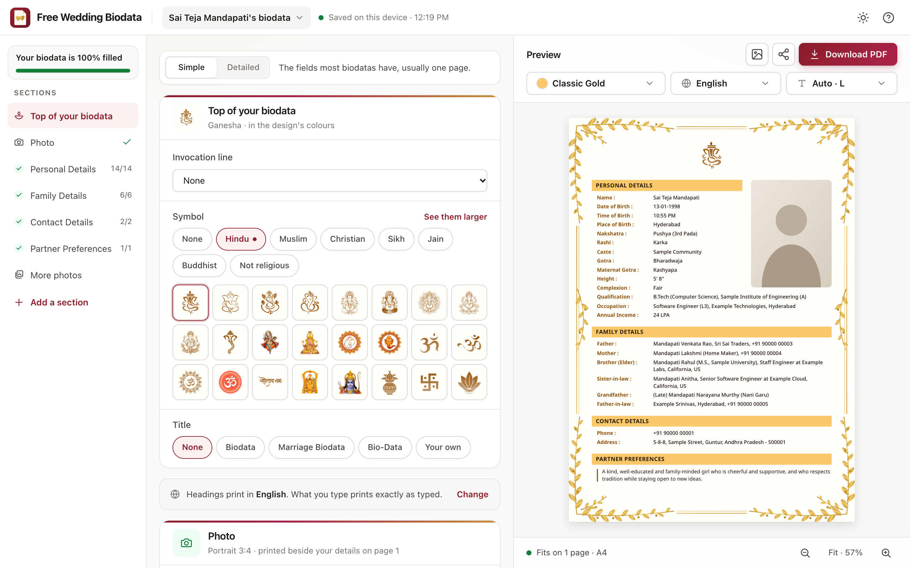
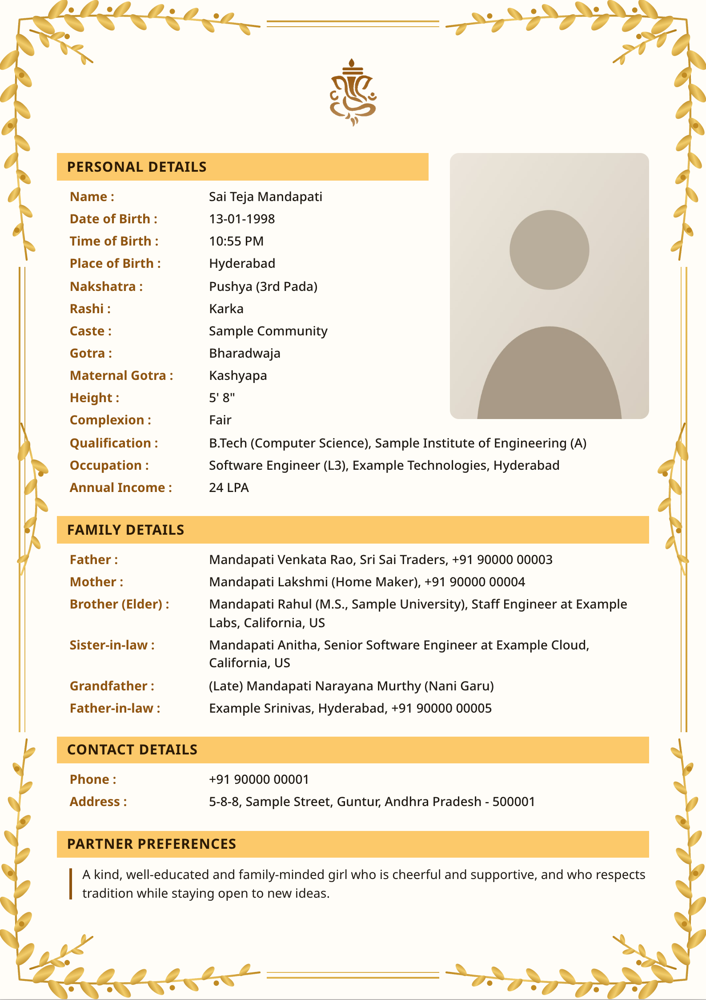
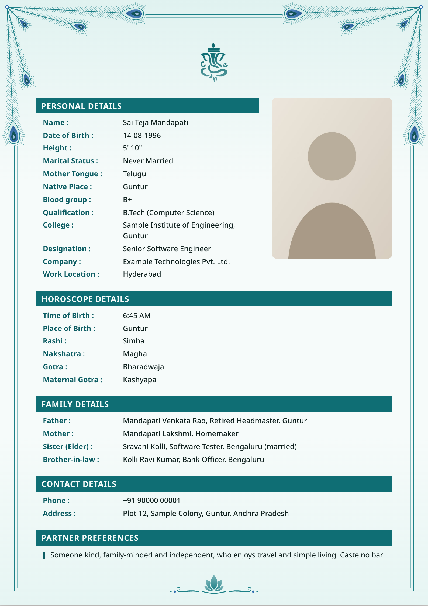
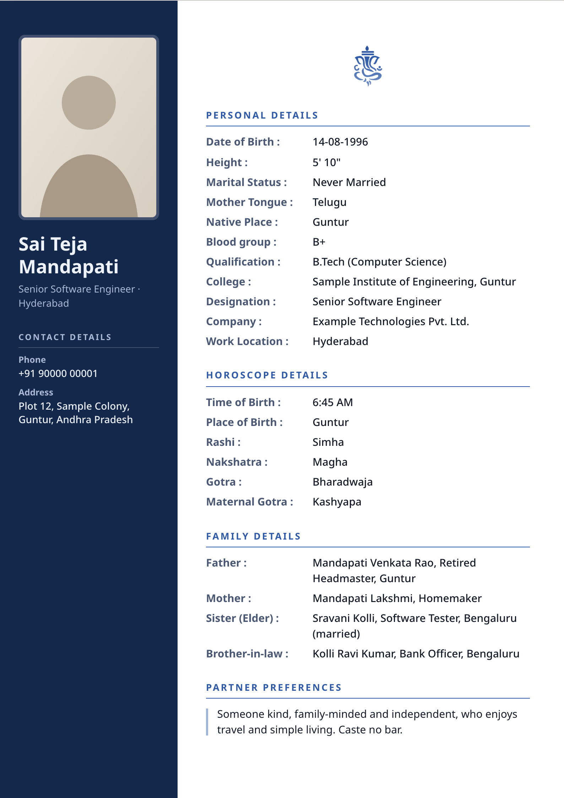
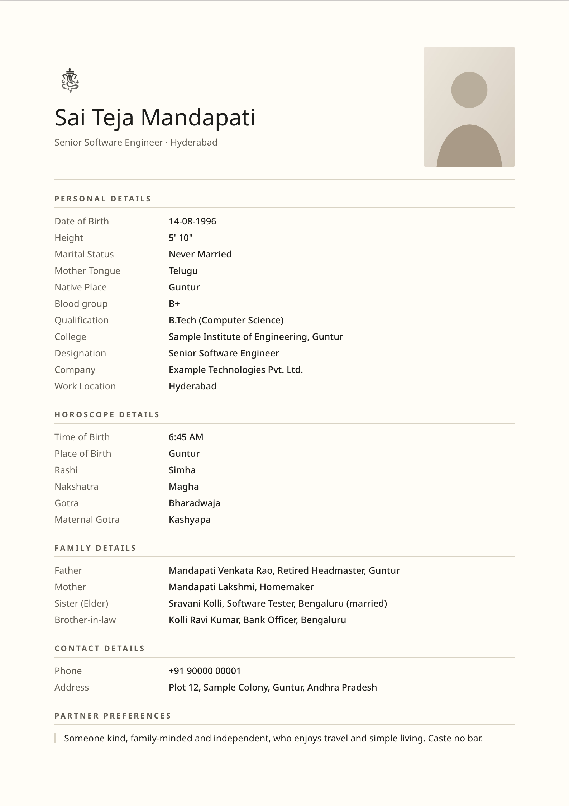

# Free Wedding Biodata

A **free, private marriage biodata maker** for India. Fill in your details, add a photo, pick a design and download an A4 biodata as a PDF or image. No login, no payment, no watermark and no ads: your biodata is saved only in your own browser and never uploaded.

**Try it:** [free-wedding-biodata.vercel.app](https://free-wedding-biodata.vercel.app)



| Classic Gold | Peacock | Executive Navy | Minimal Ivory |
|---|---|---|---|
|  |  |  |  |

Real pages made by the app, with a fictional sample. All twenty designs are on [the templates page](https://free-wedding-biodata.vercel.app/templates).

## Why

Most biodata makers ask you to sign up, upload your family's personal details to their servers, or pay to remove a watermark. This one runs entirely in the browser: the site is a set of static files, with no server, database or account, and the editor's security policy blocks it from sending anything to another site.

## What it does

- Ready-made sections (personal, education and career, family, horoscope, contact) that you can rename, hide, reorder and extend with your own fields and sections.
- A live A4 preview in 20 designs, each in three colours, with headings in English and nine Indian languages.
- Download a PDF with real text, share it on a phone, or save each page as a JPEG or PNG.
- Extra photo pages and an attached horoscope page, in the same design.
- Several drafts, autosaved on your device; a backup file to move them to another device.
- Works offline once opened, and can be installed on a phone.

## Run locally

Needs Node.js 24 or newer.

```bash
npm install
npm run dev          # http://localhost:3000
npm run lint
npm run typecheck
npm test             # Vitest; one file: npx vitest run <file>
npm run build        # static site in out/
npm run serve        # serve out/ on http://localhost:3100, as Vercel does
npm run test:e2e     # Playwright (phone and desktop) against the built site
npm run images       # icons, link and social previews, landing and gallery pictures
CAPTURE=1 npx playwright test e2e/capture.spec.ts   # retake docs/screenshots/ from the built app
```

New to the code? Start with [docs/PROJECT_GUIDE.md](docs/PROJECT_GUIDE.md).

## Documents

- [docs/VISION.md](docs/VISION.md): what the product is and the decisions behind it.
- [docs/BUILD_PLAN.md](docs/BUILD_PLAN.md): how it is built, step by step, and the progress so far.
- [docs/PROJECT_GUIDE.md](docs/PROJECT_GUIDE.md): a beginner's guide to the folders and pages.

## Known limitations

- Drafts live in one browser on one device. Clearing the browser's data deletes them, so download a backup after important changes.
- It is a document tool only: it doesn't match or connect people.

## Support

If it helped you, you can [buy me a coffee](https://buymeacoffee.com/harikiranvusirikala). Everything stays free either way.

## License

[MIT](LICENSE)
