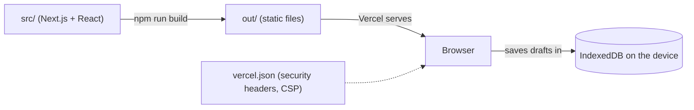

# Project guide

A beginner's tour of the code. It says what each folder and page is for; [BUILD_PLAN.md](BUILD_PLAN.md) says why and how it is built. This guide is updated in the same commit as any new folder, file or page.

## The big picture

Free Wedding Biodata is a **static website**: `npm run build` turns the code into plain HTML, CSS and JavaScript files in `out/`, and Vercel serves those files. There is no server code and no database. Everything a person types stays in their browser.

## Folders

| Path | What it holds |
|---|---|
| `src/app/` | The pages. Each folder with a `page.tsx` is an address on the site. |
| `src/app/(public)/` | Pages for everyone and for search engines: `/` (home) and `/privacy`. The brackets mean the folder name is not part of the address; its `layout.tsx` is the shared header and footer (and, from Step 6.1, the only place analytics loads). |
| `src/app/editor/` | `/editor`, where a biodata is made. It reads which draft to open from the address (`/editor?d=<id>`). For now it only shows that id. |
| `src/app/not-found.tsx` | The "page not found" screen. |
| `src/app/robots.ts` | Writes `robots.txt`: search engines may read the public pages on the live site only. |
| `src/app/icon.svg` | The app icon (a copy of `docs/brand/app-icon.svg`), used for the browser tab. `favicon.ico`, `apple-icon.png` and `opengraph-image.png` (the link preview) beside it are made from it by `npm run images`. |
| `src/app/dev/` | Development-only pages, a "page not found" on the live site unless built with `ENABLE_DEV_PAGES=1` (the e2e tests do). `/dev/pdf-spike` shows the PDF spike's reference pages. |
| `src/biodata/` | The biodata itself, as pure TypeScript: profile types and zod schema, a new draft's default sections and fields, the fictional sample, format migrations, and every edit as a small pure function (unit-tested, no browser code). |
| `src/components/` | Pieces of screen shared by several pages (`Logo.tsx`). |
| `src/lib/site.ts` | The product's name, address, title and descriptions in one place. |
| `src/lib/empty-module.ts` | An empty stand-in the bundler uses for Node's `module` in the browser (needed by the PDF text shaper). |
| `src/pdf-spike/` | The PDF spike (Step 0.2), which picked how PDFs are made: `display-list.ts` reads every line, box and picture from the laid-out pages; `vector/` writes them as a PDF, shaping Indian scripts with HarfBuzz; `raster/` draws them on a canvas for page images; `reference/` is the Classic Gold test page. Moves into `src/pdf/` and `src/document/` in Steps 3.2 and 4.1. |
| `public/` | Files served as they are: the logo (`brand/app-icon.svg`), the installable app's icons (`icons/`) and the Noto fonts with their licence (`fonts/`, copied by `npm run fonts`). |
| `scripts/` | Helper programs run with `npm run …`: `serve-out.mts` serves `out/` like Vercel; `site-images.mts` draws the icons and previews; `fonts.mts` copies the fonts; `spike-vector.mts` makes the spike's PDF in Node. |
| `test/` | Shared test setup for Vitest, and `fixtures/scripts.ts`: fictional biodata text in ten languages chosen to stress Indian-script shaping. Unit tests sit beside the code they test (`*.test.ts`). |
| `e2e/` | Playwright tests that open the built site in Chrome, on a phone and a desktop screen. `screens.spec.ts` saves a screenshot of every page at phone, tablet and desktop size in Day and Night (`test-results/screenshots/`); `spike/` makes the PDF spike's PDFs and images (`test-results/spike/`). |
| `docs/` | The vision, build plan, this guide, the brand icon (`brand/app-icon.svg`), GitHub's social preview (`social-preview.png`), pictures it is drawn from (`screenshots/`) and the PDF spike's report and evidence (`spikes/`). |
| `.github/workflows/ci.yml` | The checks GitHub runs on every push: lint, types, tests, build, e2e. |

## Configuration files

| File | What it does |
|---|---|
| `next.config.ts` | Tells Next.js to make a static site (`output: "export"`) and wires Tailwind CSS. |
| `vercel.json` | Security headers for every page. The editor's Content Security Policy only allows this site, so nothing typed can be sent elsewhere. |
| `src/app/globals.css` | The colour tokens for Day and Night (`bg-page`, `text-ink`, `bg-brand`, …). |
| `vitest.config.mts`, `playwright.config.ts` | Unit test and browser test settings. |
| `.npmrc` | Keeps `package-lock.json` free of download addresses, so it works on any machine. |

## Pages so far

| Address | File | What it shows |
|---|---|---|
| `/` | `src/app/(public)/page.tsx` | What the app is and the privacy promise. The full landing page comes in Step 6.1. |
| `/privacy` | `src/app/(public)/privacy/page.tsx` | Where a biodata is kept and how to remove it. |
| `/editor` | `src/app/editor/page.tsx` | A placeholder that proves `?d=<id>` works on a static site. |
| `/dev/pdf-spike` | `src/app/dev/pdf-spike/page.tsx` | Development only: the PDF spike's eleven reference pages. |
