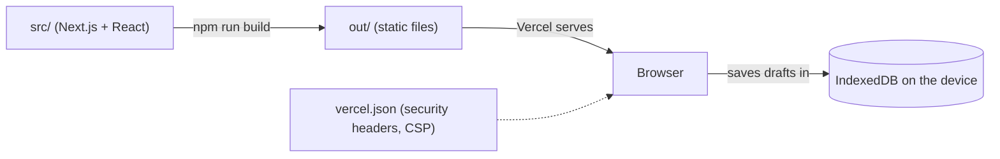

# Project guide

A beginner's tour of the code. It says what each folder and page is for; [BUILD_PLAN.md](BUILD_PLAN.md) says why and how it is built. This guide is updated in the same commit as any new folder, file or page.

## The big picture

Free Wedding Biodata is a **static website**: `npm run build` turns the code into plain HTML, CSS and JavaScript files in `out/`, and Vercel serves those files. There is no server code and no database. Everything a person types stays in their browser.

## Folders

| Path | What it holds |
|---|---|
| `src/app/` | The pages. Each folder with a `page.tsx` is an address on the site. |
| `src/app/(public)/` | Pages for everyone and for search engines: `/` (home) and `/privacy`. The brackets mean the folder name is not part of the address; its `layout.tsx` is the shared header and footer (and, from Step 6.1, the only place analytics loads). |
| `src/app/editor/` | `/editor`, where a biodata is made. `Editor.tsx` opens the draft in the address (`?d=<id>`), else the last one, else a new one, and explains drafts that can't be opened; `DraftEditor.tsx` is the open draft; `PersonalCard.tsx` the first form card; `SaveStatus.tsx` says Saving…/Saved and what to do when a save fails. `DraftsMenu.tsx` is the drafts list in the header (open, new, rename, duplicate, delete, delete all); `StorageCard.tsx` shows the space used and asks the browser to keep the drafts. |
| `src/app/not-found.tsx`, `error.tsx` | The "page not found" and "Something went wrong" screens. |
| `src/app/robots.ts` | Writes `robots.txt`: search engines may read the public pages on the live site only. |
| `src/app/icon.svg` | The app icon (a copy of `docs/brand/app-icon.svg`), used for the browser tab. `favicon.ico`, `apple-icon.png` and `opengraph-image.png` (the link preview) beside it are made from it by `npm run images`. |
| `src/app/dev/` | Development-only pages, a "page not found" on the live site unless built with `ENABLE_DEV_PAGES=1` (the e2e tests do). `/dev/pdf-spike` shows the PDF spike's reference pages. |
| `src/biodata/` | The biodata itself, as pure TypeScript: profile types and zod schema, a new draft's default sections and fields, the fictional sample, format migrations, every edit as a small pure function, and `document.ts`/`format.ts` which turn a profile into what gets printed (labels, dates, height, age); `draft-name.ts`, a draft's automatic name from the Full name. Unit-tested, no browser code. |
| `src/document/` | The document engine: page tokens, blocks, the A4 `Page`, `paginate` (pure: blocks → pages), `measure` (browser: sizes blocks off-screen), `DocumentView`; `templates/` holds one folder per design with a registry (Classic Gold, Minimal Ivory); `frames/` and `motifs/` the original artwork. |
| `src/i18n/doc/` | Printed labels per document language (English, Telugu so far); `index.ts` loads them with English fallback. |
| `src/components/` | Shared screen parts: `Logo`, `SiteHeader`/`SiteFooter` (public pages), `AppHeader` (editor), `ThemeMenu`, `ContentPage` and `SectionNav` (help and privacy), `MessageScreen` (not found, error), `Rich`, `ExternalLink`, `SkipLink`, `DeleteAllDialog` (Delete all my local data), `landing/ContinueEditing`. |
| `src/components/photo/` | The photo card (`PhotoField`: add, crop, change, remove, frame 3:4 or tall 2:3, blur warning), our own `Cropper`, `CropImage` and their icons. |
| `src/components/ui/` | The design kit (BUILD_PLAN A7): class-string recipes (button, card, field, badge, page) and `Menu`, `Dialog`, `Toast`, `Switch`, `SegmentedControl`, `Skeleton`, `EmptyState`, `PageHeader`, icons. |
| `src/i18n/app/en.json` | Every word the app shows, read with `t()` from `src/lib/i18n.ts`. |
| `src/lib/theme-script.ts`, `settings-store.ts` | Day / Night / Follow device: set before the first paint, saved in this browser. |
| `src/lib/db.ts`, `profile-repo.ts`, `autosave.ts`, `use-autosave.ts`, `open-draft.ts` | Drafts saved in this browser's IndexedDB (Dexie): the database layout; the repo, the only code that writes it (one transaction per save, checked against other tabs); autosave (writes after a short pause and when the page is hidden; "Saved" only after the write); which draft the editor opens. |
| `src/lib/draft-title.ts`, `storage-status.ts`, `local-data.ts` | A draft's shown name and "Edited 2 days ago"; how much storage is used and whether the browser will keep it; the draft the home page offers to continue, and Delete all my local data. |
| `src/lib/photos.ts`, `src/biodata/photo-crop.ts` | Getting a picked photo ready (checked, upright, at most 3000 px, JPEG) and drawing the cropped picture for the document; the crop maths (always covering the frame, dots per inch). |
| `src/lib/site.ts` | The product's name, address, title and descriptions in one place. |
| `src/lib/empty-module.ts` | An empty stand-in the bundler uses for Node's `module` in the browser (needed by the PDF text shaper). |
| `src/pdf-spike/` | The PDF spike (Step 0.2), which picked how PDFs are made: `display-list.ts` reads every line, box and picture from the laid-out pages; `vector/` writes them as a PDF, shaping Indian scripts with HarfBuzz; `raster/` draws them on a canvas for page images; `reference/` is the Classic Gold test page. Moves into `src/pdf/` and `src/document/` in Steps 3.2 and 4.1. |
| `public/` | Files served as they are: the logo (`brand/app-icon.svg`), the installable app's icons (`icons/`) and the Noto fonts with their licence (`fonts/`, copied by `npm run fonts`). |
| `scripts/` | Helper programs run with `npm run …`: `serve-out.mts` serves `out/` like Vercel; `site-images.mts` draws the icons and previews; `fonts.mts` copies the fonts; `spike-vector.mts` makes the spike's PDF in Node. |
| `test/` | Shared test setup for Vitest, and `fixtures/scripts.ts`: fictional biodata text in ten languages chosen to stress Indian-script shaping. Unit tests sit beside the code they test (`*.test.ts`). |
| `e2e/` | Playwright tests that open the built site in Chrome, on a phone and a desktop screen. `screens.spec.ts` saves a screenshot of every page at phone, tablet and desktop size in Day and Night (`test-results/screenshots/`); `spike/` makes the PDF spike's PDFs and images (`test-results/spike/`). |
| `docs/` | The vision, build plan, this guide, the brand icon (`brand/app-icon.svg`), GitHub's social preview (`social-preview.png`), pictures it is drawn from (`screenshots/`) and the PDF spike's report and evidence (`spikes/`). |
| `.github/workflows/ci.yml` | The checks GitHub runs on every push: lint, types, tests, build, e2e. |

## Configuration files

| File | What it does |
|---|---|
| `next.config.ts` | Tells Next.js to make a static site (`output: "export"`) and wires Tailwind CSS. |
| `vercel.json` | Security headers for every page. The editor's Content Security Policy only allows this site, so nothing typed can be sent elsewhere. |
| `src/app/globals.css` | The colour tokens for Day and Night (`bg-page`, `text-ink`, `bg-brand`, …). |
| `vitest.config.mts`, `playwright.config.ts` | Unit test and browser test settings. |
| `.npmrc` | Keeps `package-lock.json` free of download addresses, so it works on any machine. |

## Pages so far

| Address | File | What it shows |
|---|---|---|
| `/` | `src/app/(public)/page.tsx` | What the app is, how it works and the privacy promise. The full landing page comes in Step 6.1. |
| `/help` | `src/app/(public)/help/page.tsx` | How it works, saving, languages, printing, questions, support. |
| `/privacy` | `src/app/(public)/privacy/page.tsx` | Where a biodata is kept and how to remove it. |
| `/editor` | `src/app/editor/page.tsx` | Opens or creates a draft and saves it as you type: one Personal details card for now; the full form comes in Phase 2. |
| `/dev/ui` | `src/app/dev/ui/page.tsx` | Development only: every kit component in every state. |
| `/dev/error` | `src/app/dev/error/page.tsx` | Development only: shows the error screen. |
| `/dev/photo` | `src/app/dev/photo/page.tsx` | Development only: the photo card and cropper with in-memory storage and a drawn test picture. |
| `/dev/document` | `src/app/dev/document/page.tsx` | Development only: every template × English/Telugu × short/sample/long/split profiles at true size. |
| `/dev/pdf-spike` | `src/app/dev/pdf-spike/page.tsx` | Development only: the PDF spike's eleven reference pages. |
