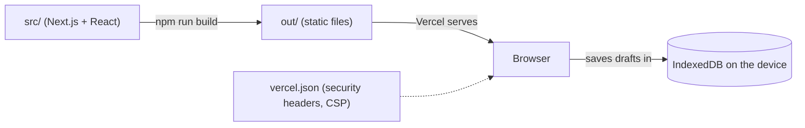

# Project guide

A beginner's tour of the code. It says what each folder and page is for; [BUILD_PLAN.md](BUILD_PLAN.md) says why and how it is built. This guide is updated in the same commit as any new folder, file or page.

## The big picture

Free Wedding Biodata is a **static website**: `npm run build` turns the code into plain HTML, CSS and JavaScript files in `out/`, and Vercel serves those files. There is no server code and no database. Everything a person types stays in their browser.

## Folders

| Path | What it holds |
|---|---|
| `src/app/` | The pages. Each folder with a `page.tsx` is an address on the site. |
| `src/app/(public)/` | Pages for everyone and for search engines: `/` (the landing page), `/templates`, `/help` and `/privacy`. The brackets mean the folder name is not part of the address; its `layout.tsx` is the shared header and footer and the only place Google Tag Manager loads (production only). `src/app/sitemap.ts` and `robots.ts` sit beside it. |
| `src/app/editor/` | `/editor`, where a biodata is made. `Editor.tsx` opens the draft in the address (`?d=<id>`), else the last one, else a new one, and explains drafts that can't be opened; `DraftEditor.tsx` is the open draft; `SectionNav.tsx` the section rail and phone chips; `SectionCard.tsx`/`FieldRow.tsx` a card per section and its rows; `FieldInputs.tsx`/`ChoiceInput.tsx` the inputs for each field type; `TopCard.tsx` the Top of your biodata card (symbol, invocation, title); `LanguageNotice.tsx` the printing language; `TraditionChips.tsx` the tradition chips (in Religion, Horoscope or Personal details); `FormLayoutSwitch.tsx` the Simple / Detailed switch at the top of the form (D50); `ManageMenus.tsx` the ⋯ menus on rows and cards; `ManageProvider.tsx` their dialogs and the Undo toast; `AddFieldDialog.tsx`/`AddSectionDialog.tsx` Add a field and Add a section; `MemberDialog.tsx` Add a family member / Change relation; `BackupProvider.tsx`, `ExportBackupDialog.tsx`, `RestoreBackupDialog.tsx` the backup dialogs and where they open from; `PhotoCard.tsx` the photo card; `PhotoPagesCard.tsx` the More photos card, the form's last card (extra photos, photos per page, horoscope chart); `labels.ts` English labels from the document dictionary; `SaveStatus.tsx` says Saving…/Saved and what to do when a save fails. `DraftsMenu.tsx` is the drafts list in the header (open, new, rename, duplicate, delete, delete all); `StorageCard.tsx` shows the space used and asks the browser to keep the drafts. |
| `src/app/not-found.tsx`, `error.tsx` | The "page not found" and "Something went wrong" screens. |
| `src/app/robots.ts` | Writes `robots.txt`: search engines may read the public pages on the live site only. |
| `src/app/icon.svg` | The app icon (a copy of `docs/brand/app-icon.svg`), used for the browser tab. `favicon.ico`, `apple-icon.png` and `opengraph-image.png` (the link preview) beside it are made from it by `npm run images`. |
| `src/app/dev/` | Development-only pages, a "page not found" on the live site unless built with `ENABLE_DEV_PAGES=1` (the e2e tests do). `/dev/pdf` checks the PDF writer; `/dev/document` shows every template. |
| `src/biodata/` | The biodata itself, as pure TypeScript: profile types and zod schema, the Simple and Detailed forms' default sections and fields (D50), the fictional sample, format migrations, every edit as a small pure function, and `document.ts`/`format.ts` which turn a profile into what gets printed (labels, dates, height, age); `draft-name.ts`, a draft's automatic name from the Full name; `inputs.ts`, typed text ↔ stored dates, times and heights; `completion.ts`, "3 of 9 filled"; `invocations.ts`, preset invocation lines and title keys. Unit-tested, no browser code. |
| `src/document/` | The document engine: page tokens, blocks, the A4 `Page`, `paginate` (pure: blocks → pages), `measure` (browser: sizes blocks off-screen), `DocumentView`; `templates/` holds one folder per design with a registry (twenty designs); `skeletons/` the Classic (as data), its letterhead variant and the Modern layouts (they also place the second photo); `frames/` the frame families, their shared geometry and the paper washes (`paper-wash.tsx`, `wash.tsx`: linear gradients only, so the PDF matches); `blocks/Letterhead.tsx` the large-name header, `blocks/BesideLead.tsx` rows beside the Classic photo and full width below it, `blocks/FitWords.tsx` a large name set smaller rather than broken mid-word (Modern panel); `motifs/` the symbol library (17 vector drawings plus 30 picture symbols in `motifs/art/`, made by `scripts/motif-art.mts`, `motif-sheet.mts` and `motif-fit.mts`); `photo-pages.ts` and `PhotoPages.tsx` the pages after the biodata (pure cell and chart layout, and the pages themselves); `relax.ts` relaxed spacing (the pure gap factor and blended block metrics); `scripts.ts` font stacks for text in another script (`textFontStack` for user values, `mixedFontStack` for invocation lines and own titles). |
| `src/i18n/doc/` | Printed labels per document language (English, Telugu so far); `index.ts` loads them with English fallback. |
| `src/components/` | Shared screen parts: `Logo`, `SiteHeader`/`SiteFooter` (public pages), `AppHeader` (editor), `ThemeMenu`, `ContentPage` and `SectionNav` (help and privacy), `MessageScreen` (not found, error), `Rich`, `ExternalLink`, `SkipLink`, `DeleteAllDialog` (Delete all my local data), `GoogleTagManager`; `landing/`: the landing page's parts (`Sections.tsx`), `ContinueEditing`, and `content.ts` (the landing questions and the structured data for search engines). |
| `src/components/photo/` | The photo card (`PhotoField`: add, crop, change, remove, frame 3:4 or tall 2:3, blur warning), our own `Cropper`, `CropImage` and their icons. |
| `src/components/ui/` | The design kit (BUILD_PLAN A7): class-string recipes (button, card with `accentCard`/`accentTile`, field, badge, page; gradient tokens and their contrast test in `src/app/theme-colours.test.ts`) and `Menu`, `Popover`, `Dialog`, `Toast`, `Switch`, `SegmentedControl`, `Skeleton`, `EmptyState`, `PageHeader`, icons. |
| `src/i18n/app/en.json` | Every word the app shows, read with `t()` from `src/lib/i18n.ts`. |
| `src/lib/theme-script.ts`, `settings-store.ts` | Day / Night / Follow device: set before the first paint, saved in this browser. |
| `src/lib/backup.ts`, `backup-file.ts`, `backup-text.ts`, `src/biodata/photo-refs.ts` | Backup files: build and parse (pure: manifest, limits, zod and migrate checks, picture sniffing); the browser side (read drafts for a file, download, read a picked file); the words for reasons and counts; every picture reference of a profile (list, swap, keep). |
| `src/lib/db.ts`, `profile-repo.ts`, `autosave.ts`, `use-autosave.ts`, `open-draft.ts` | Drafts saved in this browser's IndexedDB (Dexie): the database layout; the repo, the only code that writes it (one transaction per save, checked against other tabs); autosave (writes after a short pause and when the page is hidden; "Saved" only after the write); which draft the editor opens. |
| `src/lib/draft-title.ts`, `storage-status.ts`, `local-data.ts` | A draft's shown name and "Edited 2 days ago"; how much storage is used and whether the browser will keep it; the draft the home page offers to continue, and Delete all my local data. |
| `src/lib/photos.ts`, `src/biodata/photo-crop.ts` | Getting a picked photo ready (checked, upright, at most 3000 px, JPEG) and drawing the cropped picture for the document; the crop maths (always covering the frame, dots per inch). |
| `src/app/editor/preview/` | The live preview: `LivePreview.tsx` the desktop column and shared state; `PreviewSheet.tsx` the phone/tablet pill and sheet; `PreviewControls.tsx` design thumbnails, colours, language, text size, labels (Normal / ALL CAPS) and label wording (Standard / Telugu families); `ExportActions.tsx` Download / Share / Save image / Print and their toast; `export-files.ts` the true-size page copy, download, share, print; `layout-math.ts` zoom/fit/page maths; `page-status.ts` the page-count wording. |
| `src/lib/picture-store.ts`, `use-pictures.ts`, `picture-urls.ts` | Drawing photo-page pictures and thumbnails, as blob: URLs the Download engine reads from a registry (never fetched); `document-photo.ts` also has `useDocumentPhotos`. |
| `src/biodata/photo-pages.ts` | What prints after the biodata: frame per layout, page counts, the chart's title. |
| `src/lib/document-photo.ts` | The cropped photo for the document (a data URL), shared by `/dev/draft` and the live preview. |
| `public/sw.js`, `scripts/sw-build.mts`, `src/lib/sw-precache.ts`, `src/lib/service-worker.ts`, `src/app/manifest.ts` | Working offline: the service worker (a template; after `next build`, `sw-build.mts` writes into `out/sw.js` which files to keep and the cache version, using the rules in `sw-precache.ts`); registering it from the editor and knowing when the editor works offline; the install manifest (the installed app opens the editor). |
| `src/lib/site.ts` | The product's name, address, title and descriptions in one place. |
| `src/lib/empty-module.ts` | An empty stand-in the bundler uses for Node's `module` in the browser (needed by the PDF text shaper). |
| `src/pdf/` | The Download engine: reads the laid-out pages into a display list, then writes a PDF (HarfBuzz shapes Indian scripts, pdf-lib writes the file) or one image per page. Loaded only when downloading. |
| `public/` | Files served as they are: the logo (`brand/app-icon.svg`), the installable app's icons (`icons/`), the Noto fonts with their licence (`fonts/`, copied by `npm run fonts`), and the landing page's and gallery's pictures (`landing/`, `designs/`, made by `npm run images` from `docs/screenshots/`). |
| `scripts/` | Helper programs run with `npm run …`: `serve-out.mts` serves `out/` like Vercel; `site-images.mts` draws the icons and previews; `fonts.mts` copies the fonts; `sw-build.mts` fills in the offline worker's file list (run by `npm run build`). |
| `test/` | Shared test setup for Vitest, `fixtures/scripts.ts` (fictional biodata text in ten languages chosen to stress Indian-script shaping) and `fixtures/documents.ts` (the `/dev/document` variants: lengths, designs, colours, mixed scripts, the second photo, and each language typed in its own script for the fixture PDFs, Step 4.2 part 2). Unit tests sit beside the code they test (`*.test.ts`). |
| `e2e/` | Playwright tests that open the built site in Chrome, on a phone and a desktop screen. `screens.spec.ts` saves a screenshot of every page at phone, tablet and desktop size in Day and Night (`test-results/screenshots/`); `pdf.spec.ts` makes PDFs and page images of the templates (`test-results/pdf/`); `offline.spec.ts` checks the editor with the network off and that it makes no request to another site (the only spec that allows service workers); `landing.spec.ts` the landing page, gallery and what search engines read; `capture.spec.ts` (only with `CAPTURE=1`) retakes the real screenshots in `docs/screenshots/`. |
| `docs/` | The vision, build plan, this guide, the brand icon (`brand/app-icon.svg`), GitHub's social preview (`social-preview.png`), pictures it is drawn from (`screenshots/`) and the PDF spike's report and evidence (`spikes/`). |
| `.github/workflows/ci.yml` | The checks GitHub runs on every push: lint, types, tests, build, e2e. |

## Configuration files

| File | What it does |
|---|---|
| `next.config.ts` | Tells Next.js to make a static site (`output: "export"`) and wires Tailwind CSS. |
| `vercel.json` | Security headers for every page. The editor's Content Security Policy only allows this site, so nothing typed can be sent elsewhere. `/sw.js` is never cached by the browser (`no-cache`), so a new deploy's worker is found at once. |
| `src/app/globals.css` | The colour tokens for Day and Night (`bg-page`, `text-ink`, `bg-brand`, …). |
| `vitest.config.mts`, `playwright.config.ts` | Unit test and browser test settings. |
| `.npmrc` | Keeps `package-lock.json` free of download addresses, so it works on any machine. |

## Pages so far

| Address | File | What it shows |
|---|---|---|
| `/` | `src/app/(public)/page.tsx` | The landing page: what the app is, the product shot, how it works, languages, templates, features, privacy, questions. |
| `/templates` | `src/app/(public)/templates/page.tsx` | All twenty designs as real pages; "Use this design" opens a new draft in it (`/editor?new=1&design=<id>`). |
| `/help` | `src/app/(public)/help/page.tsx` | How it works, saving, languages, printing, questions, support. |
| `/privacy` | `src/app/(public)/privacy/page.tsx` | Where a biodata is kept and how to remove it. |
| `/editor` | `src/app/editor/page.tsx` | Opens or creates a draft and saves it as you type: every section, with an input for each field type. |
| `/dev/ui` | `src/app/dev/ui/page.tsx` | Development only: every kit component in every state. |
| `/dev/error` | `src/app/dev/error/page.tsx` | Development only: shows the error screen. |
| `/dev/photo` | `src/app/dev/photo/page.tsx` | Development only: the photo card and cropper with in-memory storage and a drawn test picture. |
| `/dev/document` | `src/app/dev/document/page.tsx` | Development only: every design × English/Telugu (and one more Indic language for designs 3–10) × short/sample/long/split, and every colour, at true size. |
| `/dev/draft` | `src/app/dev/draft/page.tsx` | Development only: a stored draft (`?d=`) laid out by the document engine, with its stored photo; `window.__draft` runs the Download engine on it (used by e2e). |
| `/dev/pdf` | `src/app/dev/pdf/page.tsx` | Development only: one page using every feature the PDF writer must draw. |
